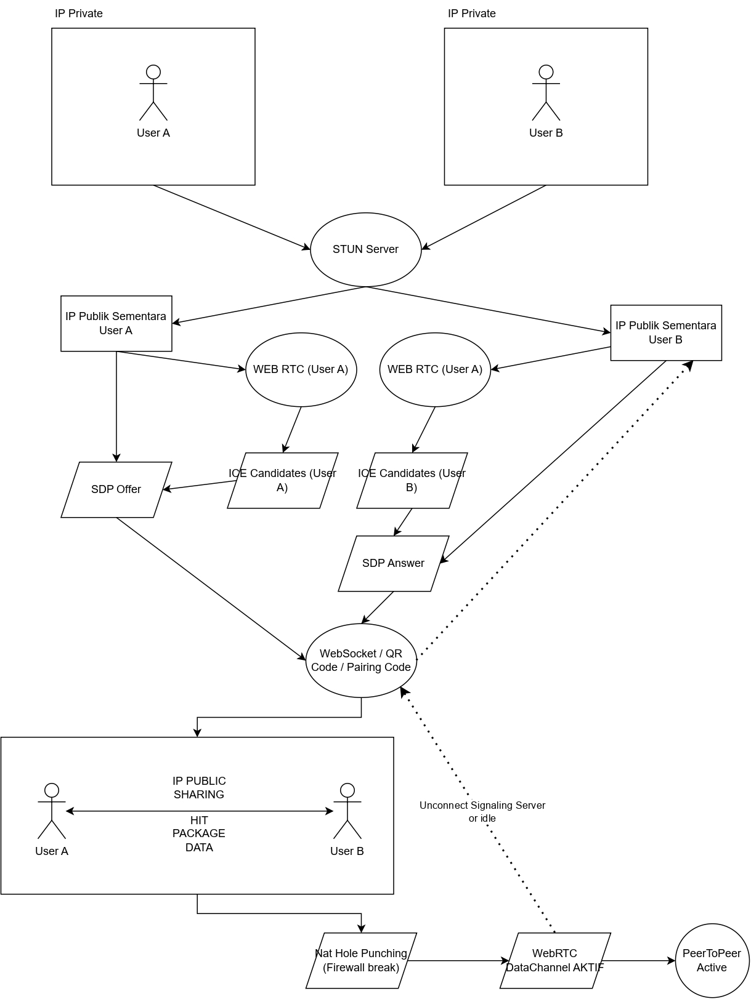

# Drople — Offline-First Activity & P2P Manager

Drople adalah aplikasi pengelola catatan dan transfer file multi-platform (Android, Linux, Windows, macOS) berbasis **offline-first**. Catatan bersifat lokal dan independen di setiap perangkat, sedangkan transfer file dilakukan langsung antar-perangkat (**Peer-to-Peer**) tanpa server cloud terpusat. Tersedia opsi backup terenkripsi end-to-end (E2EE) ke Google Drive milik pengguna.



---

## Fitur Utama

- **Offline-First & Local Storage:** SQLite lokal dengan migrasi otomatis dan write-ahead logging (WAL).
- **P2P Discovery & Pairing:** Penemuan lokal otomatis via mDNS + pairing kode/QR (`DRO1:`) dengan verifikasi fingerprint SHA-256.
- **Catatan Lokal per Perangkat:** Catatan disimpan mandiri di SQLite setiap perangkat tanpa sinkronisasi catatan antar-peer.
- **Editor WYSIWYG Ringan:** Format tebal, miring, kode, judul, daftar, checklist, dan kutipan langsung terlihat saat menulis.
- **Transfer File P2P:** Pengiriman file terpecah dalam potongan 64 KiB dengan validasi hash SHA-256 tiap potongan dan verifikasi akhir.
- **End-to-End Encryption (E2EE):**
  - Komunikasi P2P dienkripsi via Noise Protocol (libp2p).
  - Snapshot backup dienkripsi di perangkat menggunakan **XChaCha20-Poly1305** dan kunci turunan **Argon2id** dari 12 kata mnemonic recovery key.
- **Zero-Knowledge Cloud Backup:** Unggah snapshot biner (`DRPL1`) langsung ke `appDataFolder` tersembunyi di akun Google Drive pribadi pengguna. Google tidak dapat membaca isi catatan.
- **Login Google Drive Langsung:** OAuth 2.0 lewat browser sistem dengan loopback + PKCE; kredensial OAuth client cukup diatur sekali dari aplikasi.

---

## Struktur Repositori

```
drople/
├── core/                  # Rust Core Engine (P2P, SQLite, Kripto, Backup, FFI)
│   ├── Cargo.toml
│   └── src/
│       ├── backup/        # Google Drive v3 REST & snapshot biner
│       ├── crypto/        # XChaCha20-Poly1305, Argon2id, SHA-256
│       ├── db.rs          # Schema SQLite, CRUD, migrasi kolom
│       ├── ffi.rs         # Antarmuka C FFI untuk Flutter
│       ├── file/          # Chunking & transfer manager
│       ├── net/           # libp2p node, mDNS, relay, wire protocol
│       └── sync/          # CRDT merge untuk snapshot backup
├── app/                   # Flutter App (UI & Platform Integration)
│   ├── lib/
│   │   ├── ffi/           # Low-level Dart FFI bindings
│   │   ├── models/        # Data model (Note, Peer, FileTransfer, Backup)
│   │   ├── screens/       # Notes, Perangkat, Files, Backup/Cloud
│   │   ├── services/      # Service wrapper tingkat tinggi
│   │   └── widgets/       # Komponen UI bersama
│   └── native/            # Binary libdrople_core hasil kompilasi
├── docs/
│   └── FASE/              # Laporan & roadmap fase 1 s.d. 7
└── scripts/
    └── build_core.sh      # Skrip kompilasi otomatis Rust core -> Flutter native
```

---

## Panduan Membangun (Build) & Menjalankan

### Prasyarat
- Rust Toolchain 1.85+ (`rustc`, `cargo`)
- Flutter SDK 3.12+ / Dart 3.12+
- `libsqlite3` (atau gunakan bawaan bundled)

### 1. Kompilasi Rust Core
Gunakan skrip yang disediakan untuk mengkompilasi library C-shared dan menempatkannya ke direktori native Flutter:

```bash
# Debug build
./scripts/build_core.sh debug

# Release build (direkomendasikan)
./scripts/build_core.sh release
```

Output binary:
- Linux: `app/native/libdrople_core.so`
- macOS: `app/native/libdrople_core.dylib`
- Windows: `app/native/drople_core.dll`

### 2. Menjalankan Unit Tests

**Rust Core:**
```bash
cd core
cargo test
```

**Flutter App:**
```bash
cd app
flutter test
flutter analyze
```

### 3. Menjalankan Aplikasi Flutter

```bash
cd app
flutter run -d linux # atau android / windows / macos
```
---

## Lisensi
Proyek privat / mandiri oleh Virza.